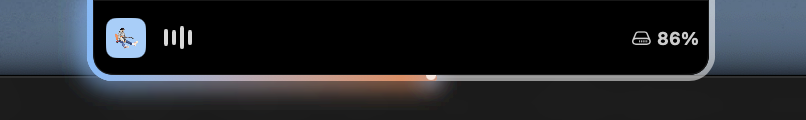
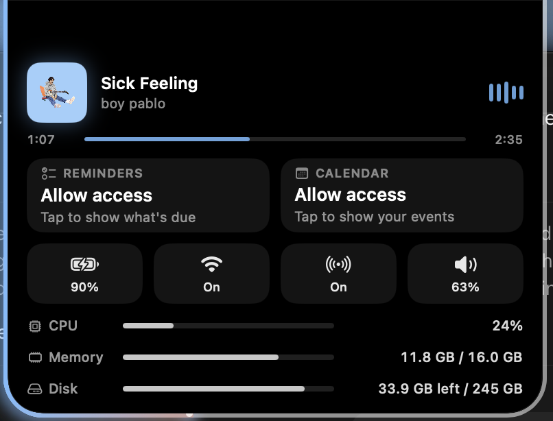
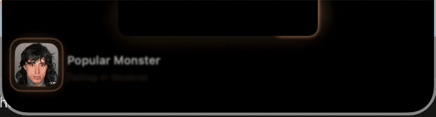
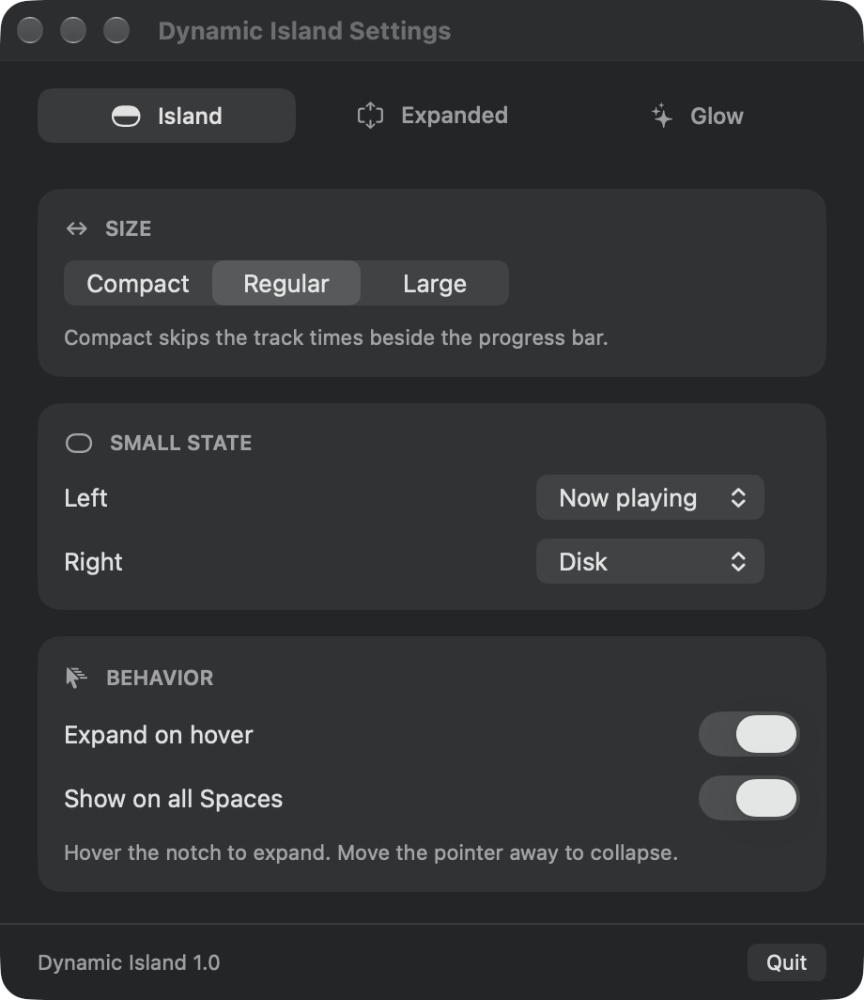
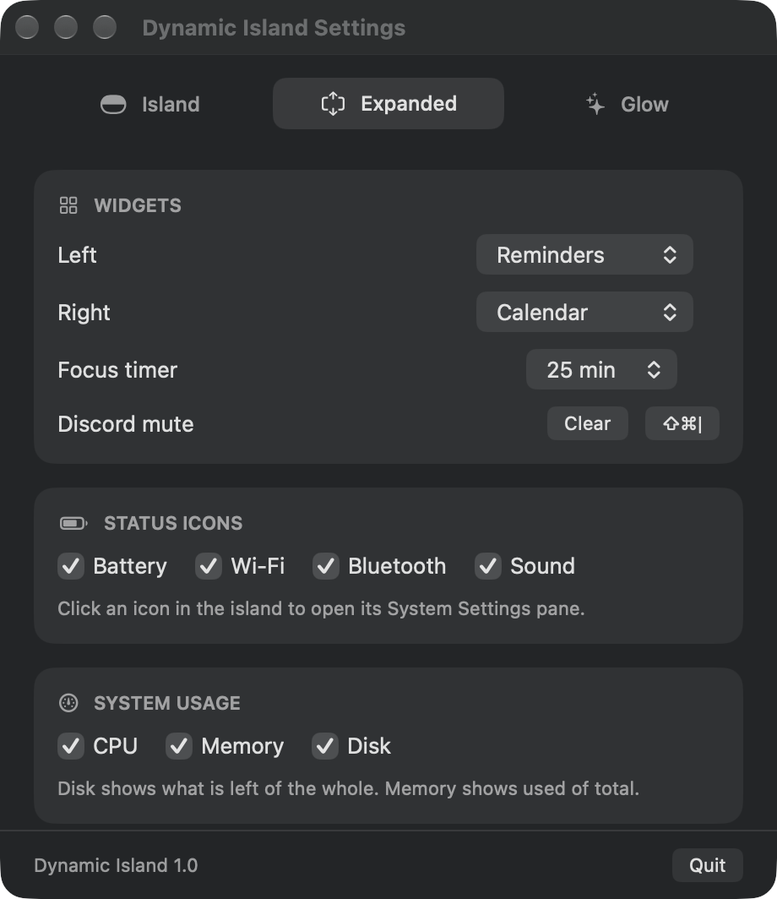
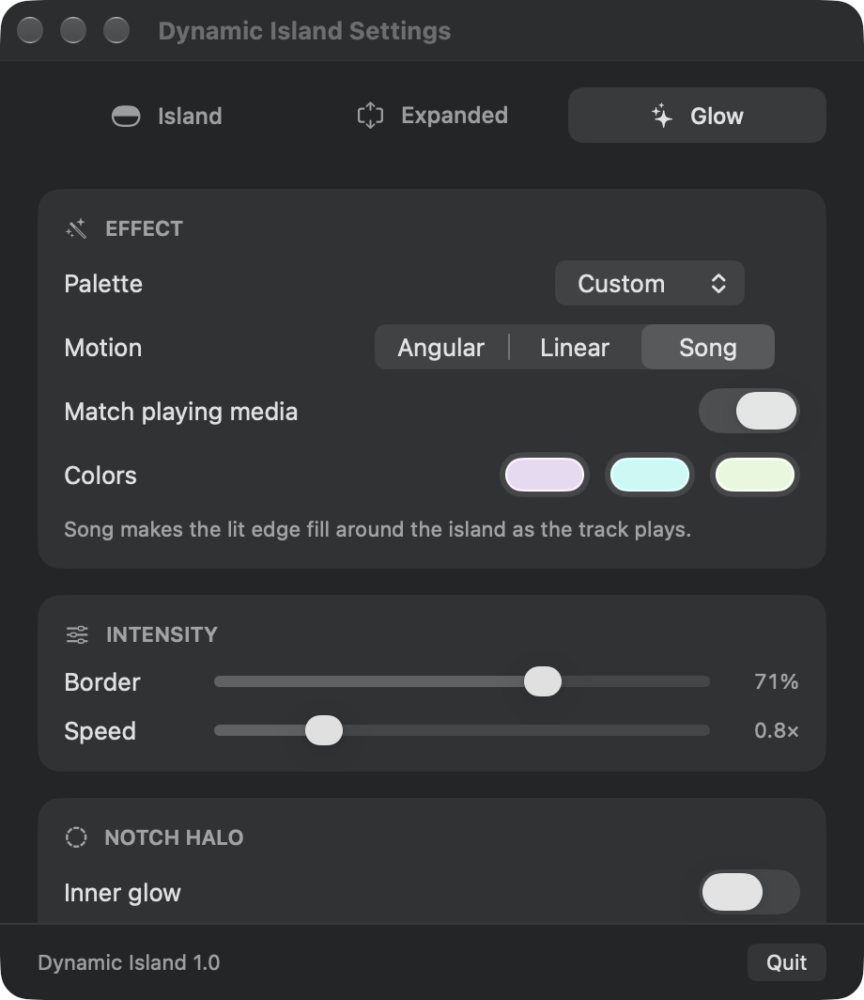

# Dynamic Island

A Dynamic Island for the MacBook notch. It sits in the notch as a small pill, and opens on hover into a panel with what is playing, your next event, system status and usage.

| Small | Expanded |
| --- | --- |
|  |  |

## Features

- **Now playing** from Music and Spotify: cover, title, artist, elapsed and total time, and the icon of the app playing it. A new song opens the island briefly with a short reveal.
- **Glow** around the island that takes its colours from the album cover. Pick a palette, or set your own.
- **Song progress**: the Song motion turns the glow into a progress line that hugs the island's edge and follows seeking.
- **Widgets** in the expanded island, two slots you choose: Calendar, Reminders, Focus timer, Clock, Battery, Discord mute.
- **Status icons** for battery, Wi-Fi, Bluetooth and sound. Click one to open its System Settings pane.
- **System usage** rows for CPU, memory and disk (space left of the whole).
- **Small state slots** either side of the notch: now playing, CPU, memory, disk or battery.
- **Live alerts**: the island widens for a moment when the charger goes in or out, the battery runs low or is full, the volume changes, a Bluetooth device connects, or the focus timer ends. Each can be switched off.
- Follows a three-finger swipe between desktops.

## A new song

When a new song starts, the island opens on its own for a few seconds: the cover springs in, the title and artist follow, and the progress line starts to fill.



## Settings

Right-click the island or use the menu bar icon to open Settings.

| Island | Expanded | Glow |
| --- | --- | --- |
|  |  |  |

## Requirements

- macOS 14 or later
- A MacBook with a notch (it also runs on other Macs, with a pill at the top of the screen)
- Xcode 15 or later to build

## Build and run

```bash
xcodebuild -project DynamicIsland.xcodeproj -scheme DynamicIsland -configuration Debug build
```

Or open `DynamicIsland.xcodeproj` in Xcode and run.

## Permissions

The app asks only for what a feature needs, when you use it:

- **Automation** for Music and Spotify, to read the current track.
- **Calendars** and **Reminders**, when you add those widgets.
- **Accessibility**, only for the Discord mute card. It presses the shortcut you bound to *Toggle Mute* in Discord's keybind settings, so Discord's mute state cannot be read back and the card only guesses it.

## Notes

- Builds are ad-hoc signed by default, so macOS treats every rebuild as a new app and Accessibility has to be granted again. To keep it, pick your own team under Signing & Capabilities in Xcode (a free Apple ID works).
- Following desktop swipes uses private macOS space calls (`CGSAddWindowsToSpaces` and related). They may change in a future macOS release; if they go missing the island stays on its current desktop.

## License

[MIT](LICENSE). Fork it, change it, ship it. It is vibe-coded, so expect rough edges.
